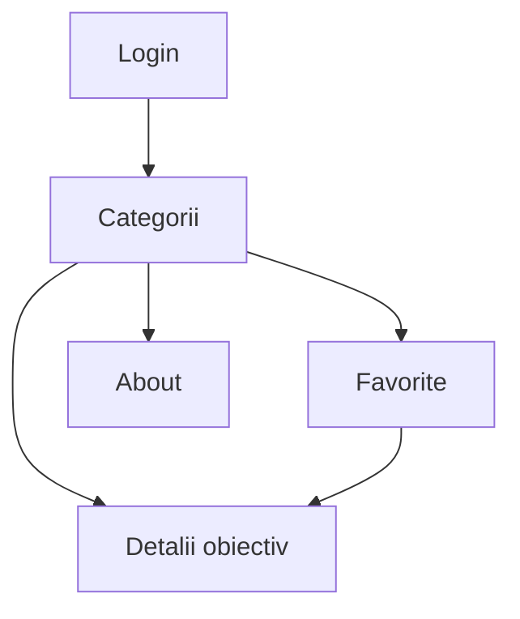

# Ghid Turistic

## Descriere
Ghid Turistic este o aplicație Android realizată în Kotlin cu Jetpack Compose, care permite utilizatorilor să exploreze obiective turistice, să consulte detalii și să salveze locurile preferate.

## Funcționalități
- Autentificare prin ecranul Login.
- Listarea obiectivelor turistice.
- Filtrarea obiectivelor după categorii: Sport, Muzee și Restaurante.
- Vizualizarea detaliilor unui obiectiv turistic.
- Adăugarea și eliminarea obiectivelor din lista de favorite.
- Ecran About cu informații despre aplicație și autor.
- Navigare prin bara de navigare inferioară.

## Tehnologii utilizate
- Kotlin
- Android Studio
- Jetpack Compose
- Navigation Compose
- Material 3
- ViewModel

## Structura navigării

## Rulare
1. Clonează repository-ul GitHub.
2. Deschide proiectul în Android Studio.
3. Așteaptă sincronizarea Gradle.
4. Rulează aplicația pe un emulator Android sau pe un dispozitiv compatibil.

## Capturi de ecran
Capturile de ecran ale aplicației se găsesc în folderul `screenshots/`.

## Autor
Costin Andrei